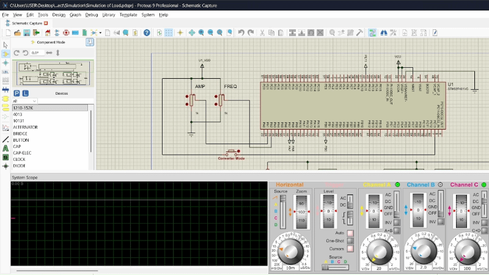
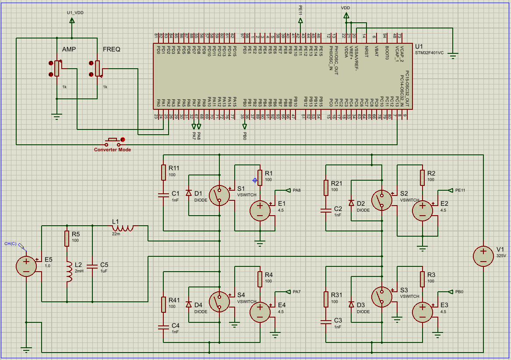
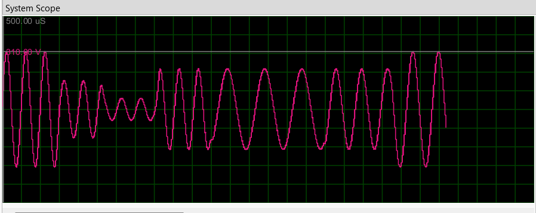
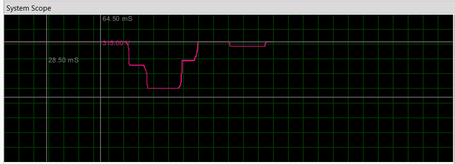
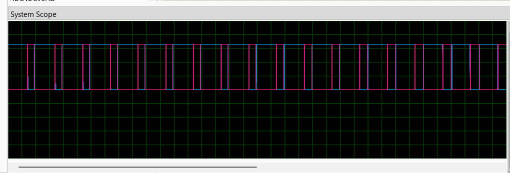
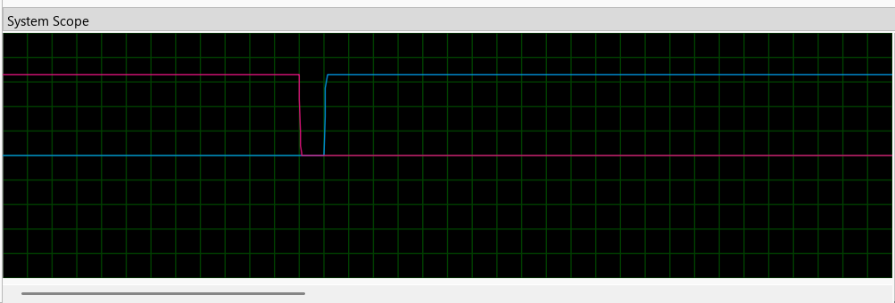

# STM32 Static Power Converter: DC/DC Chopper & DC/AC Inverter

Bare-metal firmware for an **STM32F401VC** that drives an IGBT/MOSFET **H-bridge** in two modes:

- **DC/DC chopper**: adjustable DC output from 0 to ~325 V
- **DC/AC inverter**: adjustable sine output (amplitude up to 325 V peak / 230 V RMS, frequency 50 to 100 Hz) using **unipolar sinusoidal PWM (SPWM)**

The firmware is written in C with **direct register access (CMSIS only, no HAL)**. The whole system was validated in **Proteus 9** simulation, and the complementary PWM outputs with dead-time were verified on a real **STM32F407G-DISC1** board.



---

## Features

- **Complementary PWM** at **10 kHz** on TIM1 (CH1/CH1N and CH2/CH2N) with **1 µs hardware dead-time**
- **Unipolar SPWM** generated in the TIM1 update interrupt
- **Sine reference table** recomputed only when the frequency changes, with **phase continuity**
- **Amplitude and frequency** set by two potentiometers read by ADC1
- **Operating mode** (DC/DC or DC/AC) selected by a push button
- **Clock**: 84 MHz from the internal HSI oscillator and PLL

## Screenshots

All captures below come from the Proteus 9 simulation.

### Schematic


### DC/AC mode: filtered output voltage (amplitude and frequency changed with the potentiometers)


### DC/DC mode: adjustable DC output


### Complementary PWM: PA8 (pink) and PA7 (blue)


### Zoom on one edge: 1 µs dead-time between PA8 and PA7


## System overview

```
230 V AC ──► Rectifier ──► 325 V DC bus ──► H-bridge (4 switches) ──► LC filter ──► Load
                                                  ▲
                                                  │ complementary PWM + dead-time
                                     STM32F401VC (TIM1, ADC1, GPIO)
                                                  ▲
                                 Potentiometers (amplitude, frequency) + mode button
```

## Pinout

| Pin  | Function             | Role                                   |
|------|----------------------|----------------------------------------|
| PA8  | TIM1_CH1             | Leg A, high-side switch                |
| PA7  | TIM1_CH1N            | Leg A, low-side switch                 |
| PE11 | TIM1_CH2             | Leg B, high-side switch                |
| PB0  | TIM1_CH2N            | Leg B, low-side switch                 |
| PA1  | ADC1_IN1             | Amplitude potentiometer                |
| PA2  | ADC1_IN2             | Frequency potentiometer                |
| PC13 | GPIO input (pull-down) | Mode button: low = DC/DC, high = DC/AC |

## How it works

### DC/DC mode
Leg A switches with a constant duty cycle `D = Amp / 325`, while the low-side switch of leg B stays on.
The average output voltage is `V_out = D × V_bus`.

### DC/AC mode (unipolar SPWM)
For a requested frequency `f`, a sine table of `N = 10000 / f` points is computed (one point per PWM period).
At each TIM1 update interrupt (10 kHz), the next point `s` of the table sets both legs:

```
CCR1 = (ARR + 1) × (1 + m·s) / 2      (leg A)
CCR2 = (ARR + 1) × (1 − m·s) / 2      (leg B)
```

where `m = Amp / 325` is the modulation index. When the frequency changes, the table index is rescaled
so the sine keeps the same phase.

### Timing
| Parameter | Value |
|---|---|
| System clock | 84 MHz (HSI 16 MHz → PLL) |
| TIM1 clock | 84 MHz, PSC = 0, ARR = 8399 |
| PWM frequency | 10 kHz |
| Dead-time | 84 ticks = 1 µs (DTG) |

## Project structure

```
Firmware/
├── Inc/
│   ├── config.h        # Shared constants, mode enum, register helper
│   ├── periph_init.h
│   ├── ADC.h
│   ├── apk.h
│   └── main.h
└── Src/
    ├── main.c          # Main loop: read inputs, select mode
    ├── periph_init.c   # RCC, GPIO and TIM1 initialization
    ├── ADC.c           # ADC1 init and potentiometer reading
    └── apk.c           # DC/DC and DC/AC conversion, TIM1 interrupt
Simulation/
└── Simulation of Load.pdsprj   # Proteus 9 project
```

## Build

1. Open **STM32CubeIDE**.
2. **File → Import → Existing Projects into Workspace**, then select the `Firmware` folder.
3. **Project → Build Project**. The `.hex` and `.elf` files are generated in `Debug/`.

## Simulation (Proteus 9)

1. Open `Simulation/Simulation of Load.pdsprj`.
2. Double-click the STM32 and set **Program File** to the generated `.hex` (or `.elf`).
3. Run the simulation, then turn the potentiometers and press the mode button.

Simulation model used:
- 325 V DC bus with 1 Ω series resistance
- H-bridge built with **voltage-controlled switches** and antiparallel diodes, plus RC snubbers (100 Ω / 1 nF)
- LC output filter: **L = 22 mH, C = 1 µF**
- Load: **R = 100 Ω** in series with **L = 2 mH** (motor-like)
- Output voltage measured with a differential probe (the load is floating in an H-bridge)

## Limitations and future work

- **Frequency range:** the output frequency is currently 50 to 100 Hz; the target is 1 to 100 Hz.
- **Ideal switches:** the H-bridge is simulated with ideal switches. A full simulation with real IGBT models and gate drivers (IR2110) is very slow and unstable in Proteus.
- **Open loop:** there is no closed-loop control yet; output voltage and frequency are set in open loop.
- **Planned: reversible DC/DC mode.** Drive leg B instead of leg A to get a negative output voltage, so the converter can reverse the polarity of the load (e.g. a DC motor running in both directions).
- **Other possible improvements:**
  - a soft-start ramp on the amplitude;
  - fault protection with the TIM1 break input;
  - an external HSE crystal for better frequency accuracy.

## License

This project is licensed under the MIT License. See the [LICENSE](LICENSE) file for details.
